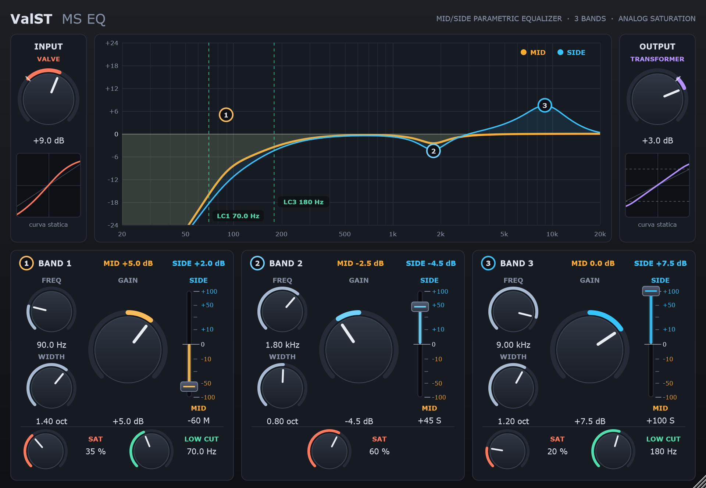

# ValST MS EQ

<p align="center">
  
</p>

Equalizzatore parametrico **Mid/Side a 3 bande con saturazione analogica**: plugin **VST3** per Windows (64 bit),
costruito con JUCE 8.

**[⬇ Scarica l'ultima versione](https://github.com/Daniele-Felicetta/ValST/releases/latest)** (file `ValST_MS_EQ_v…_Windows_x64.zip`)

## Novità della 1.1

* **INPUT**: gain di ingresso con saturazione **valvolare** (armoniche pari e dispari che crescono con il gain).
* **SAT** su ogni banda: saturazione **indipendente per banda**, la cui forma dipende da gain, frequenza e larghezza
  della banda e da un carattere proprio di ciascuna banda (fisso, salvato nel progetto).
* Le bande sono **in serie**: la 2 elabora ciò che esce dalla 1, la 3 il risultato di entrambe; i controlli restano indipendenti.
* **OUTPUT**: gain di uscita con saturazione a **trasformatore** (trasparente fino a 0 dBFS, poi compressione dolce con
  armoniche dispari).
* **LOW CUT** sulle bande 1 (6 dB/ottava, molto morbido) e 3 (12 dB/ottava).
* Supporto **mono** oltre allo stereo; 19 parametri automatizzabili.
* **Compatibile con la 1.0**: stessi ID dei 12 parametri originali, i preset vecchi suonano come prima.

Come funziona la saturazione, con formule e misure: [`docs/ARCHITETTURA_SATURAZIONE.md`](docs/ARCHITETTURA_SATURAZIONE.md).

## Installazione

1. Scarica lo zip dalla pagina delle [Release](https://github.com/Daniele-Felicetta/ValST/releases/latest) ed **estrai tutto il contenuto** in una cartella.
2. Doppio clic su **`Installa.bat`** e conferma la richiesta di Windows: il plugin viene copiato in
   `C:\Program Files\Common Files\VST3`, la cartella standard letta da tutti i DAW.
3. Apri il DAW; se **ValST MS EQ** non compare, rifai la scansione dei plugin VST3.

Per rimuoverlo: **`Disinstalla.bat`**. Non serve installare nient'altro: il runtime C++ è già dentro il plugin.

> I file non sono firmati digitalmente: Windows può mostrare un avviso di sicurezza, conferma per procedere.
> Se preferisci, compila il plugin dal sorgente (vedi [Ricompilare](#ricompilare)).

## Cosa fa

Ogni banda ha questi controlli:

| Controllo | Funzione |
|-----------|----------|
| **FREQ**  | frequenza centrale della campana, 20 Hz – 20 kHz |
| **WIDTH** | larghezza della campana in ottave (0.1 – 6); più alto = più larga |
| **GAIN**  | guadagno della banda, ±18 dB |
| **Fader Mid/Side** | accanto al GAIN: decide su quale segnale lavora il GAIN (vedi sotto) |
| **SAT** | quantità di saturazione della banda, 0 – 100 % (0 = spenta, la banda è solo la campana) |
| **LOW CUT** | solo bande 1 e 3: passa-alto, al minimo = spento (banda 1: 20 – 400 Hz; banda 3: 20 – 1000 Hz) |

E due controlli globali ai lati del grafico: **INPUT** (−12 … +24 dB, valvola) e **OUTPUT** (−24 … +12 dB, trasformatore).

### Il fader Mid/Side (scala logaritmica, da -100 a +100)

| Posizione | Effetto del pomello GAIN |
|-----------|--------------------------|
| **0** (centro) | **neutro**: agisce sul segnale stereo, cioè su Mid e Side insieme |
| verso **+100** (in alto) | agisce sul **Side**; il Mid ne riceve sempre meno, a +100 resta invariato |
| verso **-100** (in basso) | agisce sul **Mid**; il Side ne riceve sempre meno, a -100 resta invariato |

In formule, con `G` = valore del GAIN in dB e `f` = valore del fader:

```
quota   = 1 - |f| / 100
canale scelto (Side se f > 0, Mid se f < 0)  ->  G dB
altro canale                                  ->  G * quota dB
```

La corsa del fader è **logaritmica**: il valore mostrato (da -100 a +100) è legato alla posizione fisica del
cursore da una legge a decade, `valore = 100 * (10^t - 1) / 9` (con `t` = distanza dal centro, da 0 a 1).
Intorno allo 0 c'è molta corsa per pochi punti (regolazione fine, utile per dosare leggermente Mid/Side),
verso gli estremi i valori cambiano più in fretta. La scala disegnata a fianco del fader segue la stessa legge.
La definizione è in `msRange()` (`Source/Params.h`).

Dalla 1.1 il fader decide anche **dove lavora la saturazione** della banda: stessa regola del gain (il canale scelto
riceve la saturazione intera, l'altro la quota `1 - |f| / 100`).

### La saturazione

Nessuno stadio è una simulazione grafica: ciascuno agisce sul percorso audio.

| Stadio | Cosa fa |
|--------|---------|
| **INPUT** (valvola) | da −12 a 0 dB è un'attenuazione pulita. Sopra 0 dB la valvola comincia a saturare: il gain alza il livello *e* spinge la curva, quindi la distorsione cresce in modo graduale da lineare a non lineare (con un tono a −18 dB RMS: a +6 dB circa 0.09 % di distorsione, a +12 dB circa 1.4 %, a +24 dB circa 24 %). Armoniche **pari e dispari**, curva liscia, nessun clipping digitale. Metà dei dB in salita vengono compensati dopo la valvola: il volume percepito cresce meno del gain. |
| **SAT** (per banda) | satura la "fetta" di spettro che la banda controlla. A basso livello è trasparente. **Frequenza**: bande basse → curva più dura (armoniche aggressive), bande alte → più morbida. **Larghezza**: bande strette → più dura, larghe → più morbida. **Gain**: più \|gain\| → più asimmetria, cioè più armoniche pari rispetto alle dispari. Ogni banda ha un **carattere proprio** (deterministico, salvato nel progetto: stessi parametri = stesso suono, sempre). |
| **Serie** | banda 1 → banda 2 → banda 3: le armoniche create da una banda vengono elaborate dalle successive (intermodulazione reale; scambiare l'ordine cambia il suono). |
| **OUTPUT** (trasformatore) | gain di uscita + saturazione magnetica: **trasparente fino a 0 dBFS**, poi compressione progressiva con armoniche **dispari** (non è un limitatore e non taglia di netto). Sotto circa 100 Hz il nucleo satura un po' prima (fino a −2.6 dBFS). |
| **LOW CUT** | banda 1: passa-alto del 1° ordine (6 dB/ott), molto graduale, prima della saturazione della banda 1. Banda 3: 2° ordine (12 dB/ott, senza picco), dopo l'ultima banda. |

Con tutti i controlli nuovi a zero (IN 0 dB, SAT 0 %, LOW CUT spento) il plugin è l'EQ della 1.0.

### Il grafico

* curva **ambra** = risposta del segnale **Mid** (somma delle 3 bande e dei LOW CUT);
* curva **ciano** = risposta del segnale **Side** (somma delle 3 bande e dei LOW CUT);
* con il fader a 0 le due curve coincidono;
* linee tratteggiate **verdi** = frequenze dei due LOW CUT ("LC1", "LC3");
* i nodi numerati sono le bande: trascinali (orizzontale = frequenza, verticale = guadagno), rotella del mouse
  sul nodo = larghezza, doppio clic = azzera il guadagno;
* passando sopra un nodo, o sul pannello di una banda, si vedono le curve della singola banda, i valori esatti
  applicati a Mid e Side e la percentuale di SAT;
* a lato, INPUT e OUTPUT mostrano la curva statica del proprio stadio.

Il grafico usa gli stessi coefficienti dei filtri audio: quello che vedi è quello che senti (la saturazione non compare
nelle curve perché a livelli bassi, dove una risposta in frequenza ha senso, è trasparente).
Il pomello GAIN e i nodi cambiano colore con il fader: bianco = stereo, ciano = Side, ambra = Mid.
Doppio clic su qualsiasi controllo = valore predefinito. La finestra si ridimensiona dall'angolo in basso a destra.

## Dettagli tecnici

* Codifica `M = (L+R)/2`, `S = (L-R)/2`; tre filtri *peaking* (RBJ, in double, con larghezza in ottave
  pre-warped) per ciascun canale; decodifica `L = M+S`, `R = M-S`. Con tutti i gain a 0 il segnale esce
  identico bit per bit. Latenza zero.
* Ogni stadio non lineare lavora in **forma residuo**, `y = x + h(g·x)/g` con `h(s) = f(s) − s`: la parte lineare del
  segnale non passa mai dal waveshaper, quindi a livelli bassi l'uscita è identica all'ingresso (nessun filtro,
  nessun ritardo). L'anti-aliasing è **ADAA di primo ordine** sul solo residuo, senza sovracampionamento: l'aliasing
  si riduce di 4–8 dB ma non si elimina.
* Il segnale generato è privo di DC (blocco a 8 Hz sul solo residuo), niente denormali, nessuna allocazione né blocco
  nel thread audio, NaN/infiniti in ingresso neutralizzati.
* Parametri smussati (30 ms): nessun click durante le automazioni. Risultato indipendente dalla dimensione del blocco.
* 19 parametri automatizzabili: per banda `freq`, `width`, `gain`, `ms`, `sat` (`b1_freq` … `b3_sat`), più `in_gain`,
  `out_gain`, `hpf1_freq`, `hpf3_freq`, e il bypass del DAW.
* Stereo e mono (con il layout mono lavora solo il Mid).
* CPU: con tutti gli stadi attivi, 10 s di audio stereo a 48 kHz si calcolano in circa 90 ms (≈ 0.9 % di un core, misurato su
  un PC di sviluppo in Release).

Formule, legge di deformazione della curva, identità delle bande, interazione in serie, trasformatore e risultati
misurati: [`docs/ARCHITETTURA_SATURAZIONE.md`](docs/ARCHITETTURA_SATURAZIONE.md).

## Compatibilità con la 1.0

I 12 parametri della 1.0 hanno gli stessi ID, lo stesso significato e lo stesso ordine; quelli nuovi sono accodati e hanno
un valore predefinito neutro. I progetti e i preset salvati con la 1.0 si aprono nella 1.1 e suonano come prima, finché il
segnale resta sotto 0 dBFS (per i bassi sotto circa 100 Hz la soglia è fino a 2.6 dB più bassa): oltre entra in gioco il
trasformatore, che nella 1.0 non c'era. Le automazioni esistenti continuano a funzionare.

## Ricompilare

Requisiti: Visual Studio 2022 (o Build Tools) con il carico di lavoro *Sviluppo di applicazioni desktop con C++*,
CMake e git. Poi basta un doppio clic su **`build.bat`**: scarica JUCE (la prima volta), compila in Release e
genera la cartella `dist`, pronta da installare.

Test automatici (284 controlli sul codice, 311 con il VST3 compilato: matematica del fader, guadagni su Mid/Side, accordo
grafico/audio, assenza di click, saturazione valvolare / di banda / a trasformatore, interazione tra le bande, passa-alto,
gain staging, stato e preset 1.0, assenza di allocazioni, estremi, caricamento del VST3 vero come farebbe un DAW e confronto
con il codice stadio per stadio, interazione con il grafico, snapshot della GUI):

```
cmake -S . -B build -G "Visual Studio 17 2022" -A x64 -DVALST_BUILD_TESTS=ON
cmake --build build --config Release
build\ValSTTests_artefacts\Release\ValSTTests.exe --vst3 "build\ValSTMSEQ_artefacts\Release\VST3\ValST MS EQ.vst3" --out snapshot
```

```
Source/Params.h          parametri, range, scala logaritmica del fader, testi
Source/Saturation.h      curve di saturazione, ADAA, DC, seed e carattere delle bande, valvola, trasformatore
Source/MsEqDsp.h         filtri, distribuzione del gain tra Mid e Side, motore stereo, risposta lineare
Source/PluginProcessor   plugin (bus, stato, parametri, seed)
Source/EqGraph           grafico EQ interattivo
Source/PluginEditor      pannelli delle bande, INPUT / OUTPUT e finestra
Source/LookAndFeel.h     colori, pomelli, fader
Tests/Tests.cpp          test automatici
Installer/               Installa.bat, Disinstalla.bat, LEGGIMI.txt (copiati in dist)
docs/                    anteprima dell'interfaccia, ARCHITETTURA_SATURAZIONE.md
```

Per cambiare nome, produttore o categoria del plugin: `CMakeLists.txt`, blocco `juce_add_plugin`.

## Licenza

Il codice è rilasciato con licenza **GNU AGPL v3.0** (vedi [`LICENSE`](LICENSE)): puoi usarlo, studiarlo,
modificarlo e ridistribuirlo, purché le versioni derivate (anche solo in forma binaria) restino sotto AGPLv3
con il sorgente disponibile.

La scelta deriva da [JUCE](https://juce.com), distribuito con doppia licenza AGPLv3 / commerciale: per usare
questo codice in un prodotto chiuso serve una licenza commerciale JUCE.

Copyright (C) 2026 Daniele Felicetta
